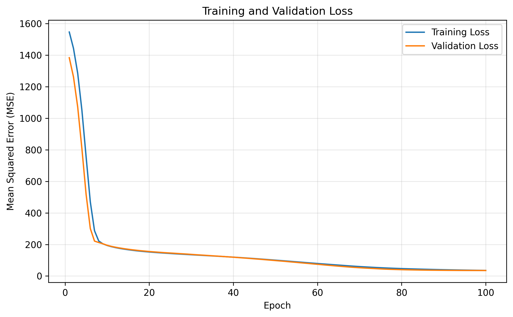
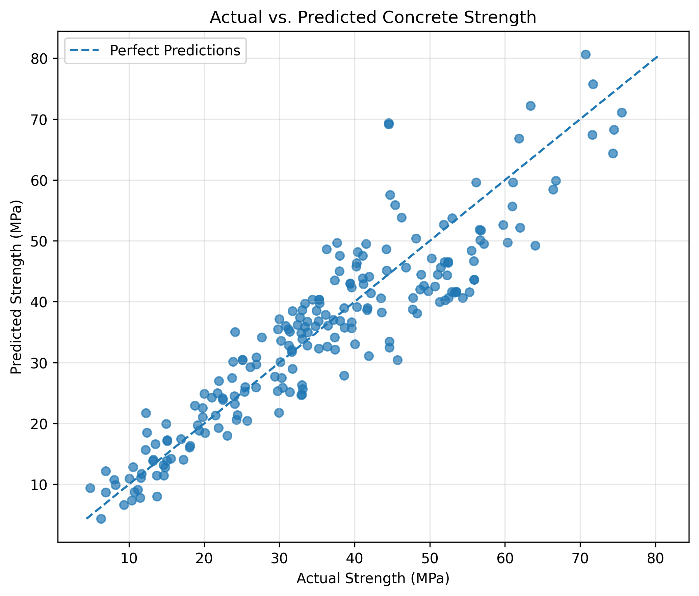

<div align="center">

# Concrete Strength Prediction Using Deep Learning

**Estimating concrete compressive strength from mix composition and curing age with TensorFlow and Keras.**

<p>
  
  
  
  
</p>

<p>
  <b>8 input features</b> &nbsp; • &nbsp; <b>3,051 trainable parameters</b> &nbsp; • &nbsp; <b>MAE: 5.079 MPa</b>
</p>

</div>

---

## Overview

Concrete compressive strength depends on the proportions of its ingredients and the age of the sample. This project builds a **feed-forward neural network regressor** that learns these relationships and predicts concrete strength in megapascals (MPa).

The implementation uses a modular Python structure with TensorFlow/Keras. It includes data validation, train/validation/test splitting, feature standardization, model training with early stopping, test-set evaluation, and visual analysis of model performance.

## Results at a Glance

<div align="center">

| Test metric | Result | What it tells us |
|:--|--:|:--|
| **MAE** | **5.079 MPa** | Average absolute prediction error |
| **MSE** | **42.095** | Mean squared prediction error |
| **RMSE** | **6.488 MPa** | Typical error magnitude in the target's unit |
| **R²** | **0.837** | The model accounts for about 83.7% of target variance on this test split |

</div>

The evaluation uses **206 held-out test samples**. These values are from a seeded run with the configuration documented below.

## Visual Results

The training-history figure compares the loss on the training and validation sets. The prediction figure compares estimated strength with measured strength; points closer to the diagonal reference line represent more accurate predictions.

<p align="center">
  
  
</p>

<p align="center">
  <sub><b>Left:</b> Training history &nbsp; • &nbsp; <b>Right:</b> Actual vs. predicted strength</sub>
</p>

## Dataset

The dataset contains measurements of concrete mixtures and their measured compressive strength.

**[⬇ Download the concrete_data.csv dataset](https://s3-api.us-geo.objectstorage.softlayer.net/cf-courses-data/CognitiveClass/DL0101EN/labs/data/concrete_data.csv)**

| Dataset detail | Value |
|:--|--:|
| Samples | 1,030 |
| Input features | 8 |
| Prediction target | `Strength` |
| Missing values | 0 |
| Problem type | Supervised regression |
| Target unit | MPa |

### Input features

| Feature | Description | Unit |
|:--|:--|:--|
| `Cement` | Cement content | kg/m³ |
| `Blast Furnace Slag` | Blast furnace slag content | kg/m³ |
| `Fly Ash` | Fly ash content | kg/m³ |
| `Water` | Water content | kg/m³ |
| `Superplasticizer` | Superplasticizer content | kg/m³ |
| `Coarse Aggregate` | Coarse aggregate content | kg/m³ |
| `Fine Aggregate` | Fine aggregate content | kg/m³ |
| `Age` | Age of the concrete sample | days |

**Target:** `Strength` — compressive strength of the concrete sample, measured in MPa.

### Dataset location

Save the downloaded file as `concrete_data.csv` in the shared `datasets` folder next to the project folder's parent structure. The configured data path expects this layout:

```text
02-Deep_learning/
├── datasets/
│   └── concrete_data.csv
└── Concrete-Strength-Prediction/
    ├── main.py
    ├── requirements.txt
    └── src/
```

The location is defined centrally in `src/config.py`.

## Model Architecture

The network is a fully connected feed-forward model with two ReLU hidden layers and a single linear output neuron.

```text
             8 input features
                    │
                    ▼
          ┌──────────────────┐
          │ Dense: 50 · ReLU │
          └──────────────────┘
                    │
                    ▼
          ┌──────────────────┐
          │ Dense: 50 · ReLU │
          └──────────────────┘
                    │
                    ▼
          ┌──────────────────┐
          │ Dense: 1 · Linear│
          └──────────────────┘
                    │
                    ▼
        Predicted strength (MPa)
```

| Component | Configuration | Purpose |
|:--|:--|:--|
| Input | 8 features | Receives standardized mixture and age measurements |
| Hidden layers | 2 × 50 neurons, ReLU | Learns nonlinear relationships in the data |
| Output layer | 1 neuron, linear activation | Produces a continuous strength estimate |
| Trainable parameters | 3,051 | Weights and biases learned during training |
| Optimizer | Adam, learning rate `0.001` | Updates model parameters using gradients |
| Loss function | Mean Squared Error (MSE) | Penalizes squared differences between predictions and measurements |
| Training metric | Mean Absolute Error (MAE) | Tracks average absolute error during training |

## Methodology

### 1. Data validation and splitting

The loader checks that the CSV exists and that all expected feature and target columns are present. Data is split into training, validation, and test subsets using a fixed random state.

| Subset | Samples | Share of dataset |
|:--|--:|--:|
| Training | 659 | 64.0% |
| Validation | 165 | 16.0% |
| Test | 206 | 20.0% |

### 2. Feature standardization

`StandardScaler` standardizes the eight input features. It is fitted using **training features only**, then applied to validation and test features with the same learned means and standard deviations. The target values remain in MPa, so the reported prediction errors are easy to interpret.

### 3. Model training

The model is trained with the Adam optimizer and MSE loss for up to 100 epochs using a batch size of 32. Early stopping monitors validation loss with a patience of 15 epochs and restores the weights from the best validation epoch. A fixed TensorFlow random seed is set for repeatable runs in the same environment.

### 4. Test evaluation

After training, the model predicts strength values for the held-out test features. The evaluator reports four regression metrics:

- **MAE:** mean absolute difference between predictions and measured strength.
- **MSE:** mean of squared prediction errors.
- **RMSE:** square root of MSE, expressed in MPa.
- **R²:** proportion of target variance explained relative to predicting the target mean.

### 5. Visualization

Matplotlib generates two figures: training/validation loss over epochs and actual-versus-predicted strength. Both are saved in `outputs/` and referenced directly above.

## Project Structure

```text
Concrete-Strength-Prediction/
├── main.py                     # Runs the end-to-end workflow
├── requirements.txt            # Python package dependencies
├── README.md                   # Project documentation
├── .gitignore                  # Excludes local files and unrelated outputs
├── outputs/
│   ├── training_history.png    # Training and validation loss
│   └── actual_vs_predicted.png # Test predictions vs. measured values
└── src/
    ├── config.py               # Paths and hyperparameters
    ├── data_loader.py          # Dataset loading and validation
    ├── preprocessing.py        # Data splitting and scaling
    ├── model.py                # Neural network definition
    ├── trainer.py              # Training and early stopping
    ├── evaluator.py            # Test metrics and predictions
    └── visualizer.py           # Performance plots
```

## Getting Started

### 1. Clone the repository

From the `02-Deep_learning` directory in your workspace, clone your GitHub repository using its URL. Name the repository `Concrete-Strength-Prediction` to keep the project name free of numbering.

```bash
git clone <repository-url>
cd Concrete-Strength-Prediction
```

### 2. Create and activate a virtual environment

**Windows PowerShell**

```powershell
python -m venv .venv
.\.venv\Scripts\Activate.ps1
```

**macOS / Linux**

```bash
python3 -m venv .venv
source .venv/bin/activate
```

### 3. Install dependencies

```bash
python -m pip install --upgrade pip
pip install -r requirements.txt
```

### 4. Download the dataset

Download [`concrete_data.csv`](https://s3-api.us-geo.objectstorage.softlayer.net/cf-courses-data/CognitiveClass/DL0101EN/labs/data/concrete_data.csv) and save it to `02-Deep_learning/datasets/concrete_data.csv`, following the directory layout in the [Dataset location](#dataset-location) section.

### 5. Run the pipeline

From the project root, run:

```bash
python main.py
```

The script loads and validates the data, splits and scales the features, builds and trains the network, prints test metrics, and generates the two visualizations under `outputs/`.

## Configuration

Paths and training settings are centralized in `src/config.py`.

| Setting | Value | Description |
|:--|--:|:--|
| `RANDOM_STATE` | `42` | Seed used for data splitting |
| `TEST_SIZE` | `0.20` | Fraction reserved for testing |
| `VALIDATION_SIZE` | `0.20` | Fraction of the post-test data used for validation |
| `HIDDEN_LAYERS` | `2` | Number of hidden Dense layers |
| `UNITS_PER_LAYER` | `50` | Neurons in each hidden layer |
| `EPOCHS` | `100` | Maximum training epochs |
| `BATCH_SIZE` | `32` | Samples per batch |
| `LEARNING_RATE` | `0.001` | Adam learning rate |
| `EARLY_STOPPING_PATIENCE` | `15` | Validation epochs allowed without improvement |

## Technology Stack

<p align="center">
  
  
  
  
  
  
  
</p>

| Technology | Role |
|:--|:--|
| Python | Core implementation language |
| TensorFlow / Keras | Neural network construction, training, and callbacks |
| Pandas | CSV loading and tabular data handling |
| NumPy | Numerical operations |
| scikit-learn | Data splitting, standardization, and regression metrics |
| Matplotlib | Performance visualization |

---

<div align="center">

**Built with Python · TensorFlow · Keras**

</div>
